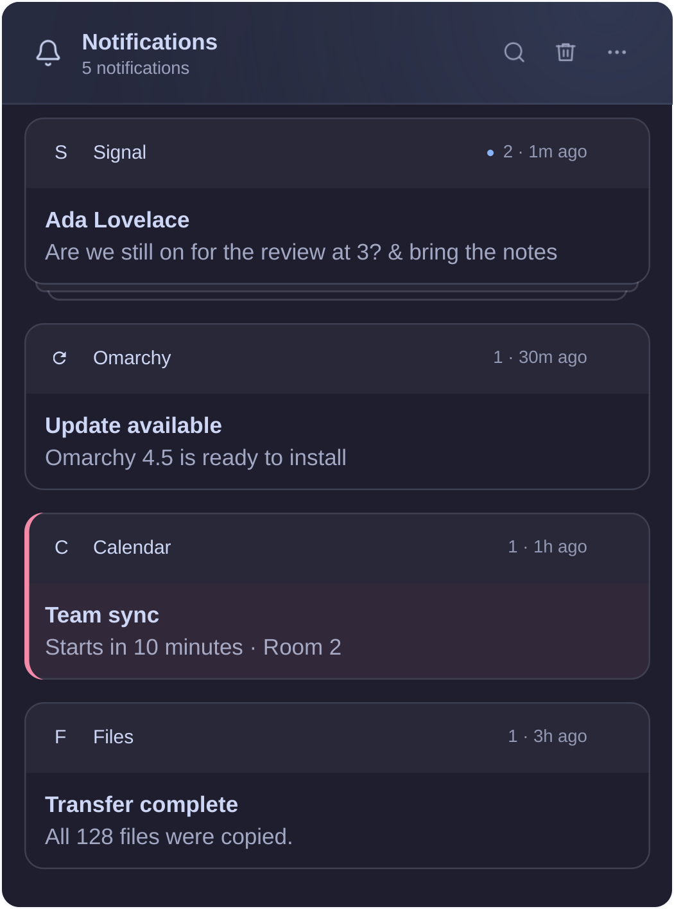

# Foamy Notification Center

Notification history with app stacks, search, and do not disturb.



## Install

Requires Omarchy 4.5 with stock notifications or Foamy Notifications enabled, `jq`, `wl-paste`, and GNU `timeout`, plus
`inotify-tools`. The archive and the website favicon lookup are a bundled helper
(`bin/x86_64`, `bin/aarch64`, built from `native/`); it needs no Python or Rust.
On other CPUs the center shows that the helper isn't available.

File-backed app icons, attached images, and picture previews require `file` and
ImageMagick 7 (`magick`). PNG, JPEG (including progressive JPEG), GIF, and WebP
files are converted outside the shell to a single PNG of at most 720 × 720 pixels.
BMP/ICO and self-contained SVG app icons and attached images are also supported.
SVG uses librsvg through ImageMagick in an empty working directory; external
resources are unavailable. Transparency and aspect ratio are preserved; themed
app icons still resolve normally.
Conversion uses a plugin-local policy: no delegates or disk pixel cache, an
8,192-pixel width/height limit, a 128 MiB pixel cache, a 512 MiB process memory
limit, and a five-second deadline, after which the converter and its children are killed.
Unsupported, oversized, or failed images are omitted; notification text remains
archived and app icons fall back to the app glyph. Missing conversion tools also
omit file-backed images rather than exposing originals to the shell. Existing
archived images are normalized before the first read, even when their sender
files have disappeared. Opening a picture still uses its original file.

```sh
omarchy plugin add https://github.com/foamrider/foamy-notification-center.git --enable
```

## Use

- Click the bell to open the center. Click an app heading to expand its stack.
- Click a notification body to open its picture or focus the sending app,
  including the visible card in a collapsed stack.
- Hover to dismiss a stack or individual notification. The trash clears the panel.
- Click search or press `/` to filter. Press Escape to close search.
- Arrow keys (or `h`/`j`/`k`/`l`) move a selection through the list; Up from
  the first row selects **More options**. Enter or Space opens the selected
  notification or expands its stack, Right (Left in right-to-left languages)
  selects its X, and Delete or `x` dismisses it. Escape closes the panel.
- Open **More options (⋯)** to silence/allow notifications, snooze them, or open
  **Settings** (last in the menu; `s` opens it too).
  Right-clicking the bar icon also toggles do not disturb.
- **More options → Snooze notifications** offers 30 minutes, 1 hour, 4 hours,
  or resume all snoozed senders. It appears only when the daemon supports timed
  snooze (Foamy Notifications); stock Omarchy has DND but no
  timed snooze, so the item is hidden there.
- Scrolling to the end loads the next 500 notifications; search covers the
  whole archive, not just the loaded part.
- Clear all stays next to search. Stack dismissal uses the X icon,
  shown on hover or keyboard selection.

Settings use the same controls as Foamy Bolt and Audio. The **Notification
center** section changes this list's browser grouping, favicons, compact view,
pictures, retention (days), and maximum archive count. **Pop-up notifications**
changes the enabled Foamy Notifications service's toasts: the snooze offer when
screen sharing starts, duplicate grouping, favicons, compact view, pictures,
normal duration (seconds), and **X removes from history**. Favicons, compact
view and pictures appear in both sections because they are separate settings:
one for this list, one for the toasts. That option
is off by default; when enabled, the popup's X button removes its whole duplicate
group from history. Right-click still hides the popup and keeps its history.
**Do not disturb also silences critical alerts** is off by default. Enable it
to send new critical alerts, including Omarchy crash alerts, directly to history
while DND is active. Transient alerts are not stored. Normal Omarchy action
feedback and delivery outside DND are unchanged.
Hostname/browser stacks belong only to
the center; popups group exact duplicates with matching actions.

Changes save immediately. Center settings save through the host
(`updateEntryInline`, else `omarchy bar set`). Popup settings are read and
saved by Foamy Notifications itself over its IPC (`preferences`,
`setPreference`): the center never edits another plugin's `shell.json` entry.
Popup settings are hidden when Foamy Notifications is unavailable (or too old
to answer); its section shows a muted "Plugin not installed" or "Plugin not
enabled" message. Opening this panel does not enable it. Invalid values and
save/read failures are shown in the panel. Back or Escape returns from Settings; dropdowns
and numeric editors consume Escape first to cancel their edit.

Select the desktop language in **Omarchy → Setup → Language**. Existing widget `language` values are ignored.

Set `useBrowserFavicons` on the widget entry to `true` (default) to show a
website’s locally cached favicon, with the app icon and then the glyph as
fallbacks. Set `browserGrouping` to `"browser"` (default), `"hostname"`, or
`"none"`. Hostname mode gives each identified website its own stack and heading;
none leaves each browser notification separate. Native apps keep their stacks.
Missing website identities remain under the browser. A browser-wide stack with
several websites keeps the browser icon because it has no single website identity.

For example, on the `foamy.notification-center` widget entry:

```json
"useBrowserFavicons": true,
"browserGrouping": "hostname"
```

Website identity comes only from a browser’s leading HTTP(S) URL/link or a bare
hostname on its own first line. Links inside the message and sender avatars do
not identify the site. Grouping does not change click targets or distinguish
browser profiles/accounts. These settings are independent of Foamy Notifications.

Search and numeric settings use bounded clipboard reads (16 KiB, two seconds).
Failed paste leaves the field unchanged and displays an error. Keyboard paste,
the context menu, and primary-selection paste use the same limits.

Favicons are read asynchronously from standard Linux Vivaldi, Chrome, Chromium,
Brave, Edge and Opera profile caches. Firefox, custom profile locations and missing
icons fall back to the app icon. This also works with stock Omarchy notifications
when the sender’s website origin is present in the archived body. No website
requests are made. PNG copies use the shared private cache
at `$XDG_CACHE_HOME/foamy/browser-favicons` (normally `~/.cache/foamy/browser-favicons`),
limited to 256 icons of at most 64 KiB and 256 × 256 pixels. Successful lookups
refresh after one day; missing icons can retry after five minutes on a display
model change. Lookups cover only the first 128 groups in the display.

Browser databases are opened read-only. If a rollback database is locked, the
helper can read an in-memory copy of at most 32 MiB. It rejects active
journals, WAL sidecars, changed files and copies that fail a structural
check. Copying and querying share a two-second deadline. No database copies are
written to disk; the helper never writes to the browser database or removes its
locks. A cache that cannot be read safely keeps the app icon and reports
`cache-unavailable`.

Set `compact` on the widget entry in `shell.json` to `true` for a slim app
header and tighter message spacing. The default, `false`, keeps the roomier
cards. Text and picture sizes stay unchanged. This setting is independent of
Foamy Notifications, which defaults to compact popups.

Other widget entry keys: `badge` marks unread notifications on the bell
(`"Dot"` default, `"Highlight"`, `"Count"` or `"None"`), `showBody: false`
hides message text, `showPreview: false` hides pictures and stops archiving new
ones, `panelWidth` (default 420) sets the panel width and `listHeight` caps the
list (default 0: down to the bottom of the screen).

Cards use the same motion as Foamy popups: a 180 ms fade with an 8 px lift on
arrival and a 120 ms fade on removal. The departed row then collapses over
140 ms so remaining cards move smoothly. The panel height also animates.
Message updates retain their card, and scrolling does not replay the entrance.

Keeps up to 1,000 notifications for 30 days by default. The archive's
invariants (identity is the key; equal timestamps are ordered by key; removed
notifications never return while a source still holds a copy; rows still in the
archive always take updates; what each source can resurrect and how tombstones
prevent it) are written at the top of `native/src/main.rs` and checked by
the randomised `tests/retention-property.test.js`. Retention is enforced
when the watcher starts, after new arrivals that cross a limit, and hourly while
nothing arrives; expired entries never show. **Clear all deletes** the archived
entries and their images (and asks Foamy Notifications to drop its own copies). Silenced notifications
remain in history; stock Omarchy exceptions still apply.

The default `clickAction: "Auto"` first tries the current popup action through
Foamy Notifications. If that action is unavailable, it opens an absolute PNG,
JPEG, GIF, or WebP path, or focuses the sending app when no image is available.
The standard two-argument `omasnap` or legacy `tensaku-edit` screenshot action becomes a fixed
`edit-screenshot` intent, so screenshots remain editable after expiry or
reload. Editing prefers Omasnap, falls back to Tensaku, and finally to
`xdg-open` when neither editor is installed. Other images open with `xdg-open`. Missing files, unavailable apps, or immediate launch failures leave
the entry available for retry.

With Foamy Notifications, a notification it received in this shell keeps the
popup's click and buttons here for 24 hours: the sender's own actions while the
sender is live, and Omarchy click commands and `--action` buttons. Foamy holds
them in memory and runs them (`centerActions`, `invokeCenterAction`); the center
only shows their labels and passes on which one was pressed (number keys 1–9 on
the keyboard cursor's row). They are gone after a shell restart, 100 newer
notifications, or 24 hours, and the row then falls back as below.

Sender commands (`exec` and `execArgv`) are never replayed or kept in the archive.
Custom screenshot editors work while their popup action is live; after expiry,
they use the image viewer. Existing archived commands are removed on the next
sync. Previously disarmed entries gain screenshot editing only when their
original notification source still exists; the editor cannot be inferred from
an image path alone.
Set `clickAction` to `"Focus the app"` to skip pictures and live actions, or
`"Nothing"` to disable notification body clicks. Closed app callbacks and URL
actions cannot be replayed.

When used with Foamy Notifications, activating a popup removes it from this center
and clears its unread state. Right-click dismissal keeps it in history. × also
keeps history unless `closeButtonRemovesHistory` is enabled on the
`foamy.notifications` service entry. The public `foamy.notification-center.store remove` IPC command accepts
comma-separated notification keys and performs a durable removal. The companion
`handled` command only updates the in-memory list after a caller has already
committed that removal; Foamy Notifications uses this to avoid a second archive
rewrite. Both accept at most 100 exact `timestamp-id` keys.

Stock Omarchy 4.5 stores arrays in `live.json` and `history.json`. The reader
accepts those arrays as well as the older per-file format (one file per
notification) that Foamy Notifications keeps. Stock
identities stay stable across updates and moves into history; updates do not
become unread again. Only changed stock rows are ingested. Malformed or oversized
arrays report a read error rather than silently returning an empty history.
Stock aggregate files are read-only: center removal/clear affects the center's
archive, not stock's own history panel or visible popups. Notification text in
history rows follows stock 4.5 `Markup.oneLine` (entities decoded, markup dropped). Stock 4.5 does not save
images, so those entries generally have app icons rather than historical avatars.
Its redacted verification-code placeholders remain redacted.

Updates to an existing notification replace its archived content without creating
another unread item. The watcher reconciles at startup and after reconnecting,
then reports source and archive changes. Ingesting a notification starts no
process unless it brings an image to convert, and retention rewrites happen
only when a limit can have been crossed.

### Foamy Notifications contract

The two plugins talk over IPC only; neither reads the other's config, runs the
other's scripts, or writes or deletes the other's files. The center asks
`foamy.notifications storeInfo` where Foamy's popup/history files and its
`handled` journal are (read-only here); without an answer it reads stock
Omarchy (`~/.local/state/omarchy/notifications`, arrays or older per-file archives),
and an older Foamy without `storeInfo` is read at its legacy location. Dismissing
or clearing here asks Foamy (`releaseHistory`, `releaseHistoryBefore`) to drop its
copies; Foamy reports handled clicks with `foamy.notification-center.store
handled` and in its journal, and tells the center to re-read with `peerChanged`.
These calls are answered in-process.
Changing the enabled plugin in `shell.json` re-resolves the source. There is no periodic archive polling;
opening the panel also requests a fresh list. Reads which overlap newer events
are retried, and duplicate filesystem events skip retention work.

When Foamy Notifications is running, Auto clicks without pictures request the exact live
notification's default action, letting the browser or app open its own destination.
Foamy keeps live browser callbacks available when popups expire, are hidden, or
are silenced. Clicking those history entries can still open the original destination.
Callbacks are limited to the newest 100 retained actions in the current shell
session. Sender closure, history dismissal or clearing, disabling the center,
and eviction release them. A browser or shell restart cannot restore old callbacks.
Unavailable callbacks, older Foamy versions, and stock Omarchy Notifications
fall back to the stock app-focus helper. No browser mappings are
required for center clicks. Failed focus keeps the entry available with an error.
The center never extracts links from message text or replays archived commands.

Text-only replacements reuse retained images and previews. Each plugin still owns
its own image lifetime and cleanup: the center's longer retention does not depend
on the popup cache. Changed source files invalidate thumbnail reuse; conversion
limits and text-only fallback remain in place.

## Verifying the helper binaries

`bin/x86_64/foamy-notification-center-helper` and `bin/aarch64/foamy-notification-center-helper` are compiled from the Rust source in this repository: `native/`, the
shared crate in `kit/rust/`, the dependencies locked in `Cargo.lock` and the
toolchain pinned in `rust-toolchain.toml`, with the build tool in
`kit/native/`. The build is reproducible. `native/native.pin` records the
toolchain, a hash of every build input (`source`) and the SHA-256 of each
binary.

**CI.** The [Verify native helpers](https://github.com/foamrider/foamy-notification-center/actions/workflows/verify-native.yml)
workflow rebuilds both binaries on a GitHub-hosted runner for every push,
compares them byte for byte with `bin/`, and attests the rebuilt files. To
check the committed files against that attestation (GitHub CLI):

```sh
gh attestation verify bin/x86_64/foamy-notification-center-helper --repo foamrider/foamy-notification-center \
  --signer-workflow foamrider/foamy-notification-center/.github/workflows/verify-native.yml \
  --deny-self-hosted-runners
gh attestation verify bin/aarch64/foamy-notification-center-helper --repo foamrider/foamy-notification-center \
  --signer-workflow foamrider/foamy-notification-center/.github/workflows/verify-native.yml \
  --deny-self-hosted-runners
```

Add `--source-digest <commit>` to require a particular commit.

**Yourself.** You need `rustup`, Python 3.11 or newer and `file`. From a
checkout of this repository at the commit you want to check:

```sh
rustup toolchain install "$(awk '$1 == "toolchain" { print $2 }' native/native.pin)" \
  --profile minimal --target x86_64-unknown-linux-musl,aarch64-unknown-linux-musl
kit/native/build-native.sh . --verify
```

It builds both binaries from scratch in `~/.cache/foamy-native/` (nothing is
written to the checkout), compares them byte for byte with `bin/`, checks
that the kit files are unmodified and that `native.pin` matches the source,
and ends with `verify OK (foamy-notification-center-helper, <toolchain>, both arches reproducible)`.

### Building the helper yourself

To run binaries you built instead of the committed ones, build them in the
installed plugin with the same toolchain, then run `omarchy restart shell`:

```sh
cd ~/.config/omarchy/plugins/foamy.notification-center
kit/native/build-native.sh .
```

The build is reproducible, so `git status` shows no change when your
binaries match the release, and `omarchy plugin update` still applies.

## Remove

```sh
omarchy plugin remove foamy.notification-center
```

Removing the plugin leaves stock notifications running. Notification history,
saved images, and the current do-not-disturb setting remain on disk. The plugin's
archive and images are under `$XDG_STATE_HOME/omarchy-notification-center`
(default `~/.local/state/omarchy-notification-center`). Stock notification files
(stock under `~/.local/state/omarchy/notifications`, Foamy under
`~/.local/state/foamy-notifications`) belong to those daemons and are retained. Review these
directories separately if you want to delete history.

Omarchy manages the plugin entry in `shell.json`. Packages and data outside
the plugin directory are retained unless you remove them separately.

## License

`kit/` holds shared components copied from [foamy-kit](https://github.com/foamrider/foamy-kit); edit them there, not here.

[MIT](LICENSE). Based on [Omarchy Notification Center](https://github.com/jankeesvw/omarchy-notification-center).
Omarchy and Lucide notices are in [LICENSE-OMARCHY](LICENSE-OMARCHY) and
[LICENSE-LUCIDE](LICENSE-LUCIDE).

Provided **as is**, without warranty or guaranteed support. Use at your own risk.

Card animations can be checked with `python3 tests/motion.py` (isolated Qt) or
`python3 tests/motion.py --desktop` (Wayland). Both use synthetic history.

Stock compatibility can be checked without touching personal history:

```sh
node --test tests/*.test.js tests/*.test.cjs
python3 -I -m unittest discover -s tests -p '*_test.py' -v
bash tests/kit-check.sh
python3 tests/browser-ui.py
python3 tests/settings-ui.py
python3 tests/settings-number.py
python3 tests/images-ui.py
python3 tests/rtl-rows.py
python3 tests/scrolling.py
python3 tests/stock-runtime.py
python3 tests/stock-runtime.py --custom
```

These checks use a private D-Bus session and temporary home directory. The
store and favicon tests run the helper as a process: `FOAMY_HELPER` (a JSON
argv prefix, e.g. `'["/path/bin/aarch64/foamy-notification-center-helper"]'`)
selects another build; the default is `bin/<machine>/`. `tests/contract.test.js`
pins the exact output and file formats.

The helper is Rust (`native/`, contract at the top of `native/src/main.rs`) and
is committed prebuilt. After changing it, rebuild both architectures
reproducibly and check them with the tool in `kit/native/` (rustup with the toolchain
from `rust-toolchain.toml`, `file`, and qemu-user binfmt for the aarch64 tests):

```sh
kit/native/build-native.sh . --test    # fmt, clippy, cargo test
kit/native/build-native.sh .           # bin/x86_64, bin/aarch64, native/native.pin
kit/native/build-native.sh . --verify  # clean rebuild, byte compare
bash tests/kit-check.sh
```
`settings-ui.py` and `images-ui.py` require a running Wayland session. The
tests load the installed Omarchy 4.5 shell (`/usr/share/omarchy`; only its QML
and data, never its scripts) through foamy-kit's `preview/hostenv.py`, from the
kit checkout at `$FOAMY_KIT` (default `~/GitHub/Personal/foamy-kit`): every
`omarchy` command is a logging stub or a test double, `omarchy-shell` reaches
only the test's own shell, and the system bus and audio server are dead
addresses. Set `OMARCHY_TEST_ROOT` to another Omarchy tree, or
`FOAMY_HOST_45` to its `shell/` directory, to exercise that release without
installing it. Both the stock service and Foamy service paths need validation; a
fixture alone does not establish compatibility with a full OS upgrade.

Language follows **Omarchy → Setup → Language** on Omarchy 4.5. Plugin language overrides are no longer used. Missing translations fall back to English.

Translation checks: `python3 "$FOAMY_KIT/preview/i18n_runtime.py" .` (foamy-kit's shared check) switches the language live on the installed Omarchy 4.5 shell and checks the catalogs, their English fallback and literal values.
